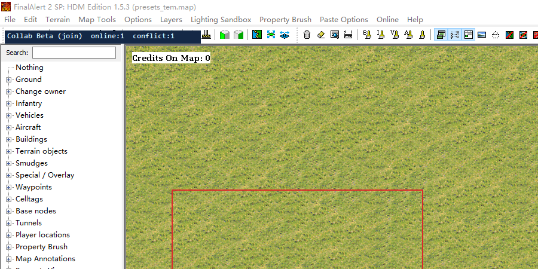
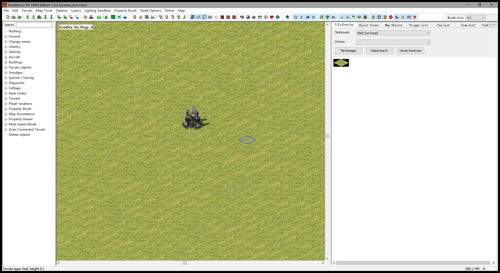

# FA2sp Collab · 红警地编联机协作

[](https://github.com/SwampyVoyage749/fa2collab/releases)
[](https://github.com/SwampyVoyage749/fa2collab/releases)
[](LICENSE)
[](https://github.com/handama/FA2sp)

**[⬇ 下载最新版（含编译好的 DLL，解压即用）](https://github.com/SwampyVoyage749/fa2collab/releases/latest)**

> [!IMPORTANT]
> **本插件完全由 DeepSeek-V4.1-Flash 生成**
> 从局域网同步内核、FA2 内部渲染表重建，到全部测试脚本与文档，均由它完成。

让 **FinalAlert 2 SP（HDM Edition）** 支持**两个人同时编辑同一张地图**的联机插件：
地形、矿石、单位、建筑、触发/INI 全部实时互通，谁在改哪一块看得见，抢同一块会被拦住。

做图的可以各自负责一片区域；写 INI 的可以一个人调触发、另一个人摆房屋，不用再"你改完发我我改完发你"。




## 特性

| 能力 | 状态 |
|---|---|
| 同图校验（哈希不一致拒绝连接） | ✅ |
| 光标 / 名字 / 工具 / 笔刷 / 框选 同步 | ✅ |
| 地形 + 覆盖图（矿石等）**逐格增量**同步（约 200ms） | ✅ |
| **物件同步**：建筑 / 车辆 / 步兵 / 飞机（约 0.5s，含渲染刷新） | ✅ v0.4 |
| **删除同步**：删建筑 / 单位 / 触发 → 对端同步删除 | ✅ v0.4.1（默认开） |
| **崩溃修复**：对端光标跑出地图不再让 FA2 崩 | ✅ v0.4.2 |
| **悬停信息**：建筑/车辆/步兵/飞机 显示 Cost / Sight / Speed（Ctrl+H 任意工具下常显） | ✅ v0.5 |
| **预览模式**：`Ctrl+P` 让地图里带 art 动画的建筑按 `Animation` 段真正动起来（关预览自动恢复原光照） | ✅ v0.5.1（实验性） |
| 地图内嵌 INI 节同步（Triggers / Events / Actions / TeamTypes / TaskForces / ScriptTypes / Waypoints / Houses…） | ✅ |
| 触发按 ID 三方合并（不同键共存，同键冲突记日志） | ✅ |
| 16×16 区块租约：别人占着就改不动，硬改会被还原（撤销也一样） | ✅ |
| 冲突红框 / 状态条 / 玩家列表 | ✅ |
| 中途加入自动补全量快照（地形 + INI + 物件） | ✅ |
| 断线自动重连 | ✅ |
| 房间设置窗（`Ctrl+Alt+C`） | ✅ |

| 公网/NAT 穿透 | ❌ 只支持局域网或虚拟局域网（Radmin VPN / UU 等） |

## 地图自检（Ctrl+Shift+C）

开图后按 **Ctrl+Shift+C**，扫一遍这张图的引用完整性，结果：

- 弹窗列出问题（显示问题）
- 同时在地图旁边写一份 地图名.mapcheck.txt（GBK，记事本直接可读）

检查项：

| 检查 | 说明 |
|---|---|
| Tag → Trigger | [Tags] 第三段指向的触发器不存在 |
| Trigger 空 | 没有 [Events] / [Actions]，或数量字段 ≤ 0 |
| 事件/动作 type=0 | 空事件、空动作 |
| TeamType → Script | Script= 指向的脚本不存在 |
| Action type=7 → TeamType | 动作里引用的队伍不存在 |

每条问题都会带上**触发器名字**，方便在 Trigger List 里搜。

想开图即查：FAData.ini 里 [ExtConfigs] 加 MapSelfCheckOnLoad=1。

## 预览模式（v0.5.1，实验性）

做图时想直接看建筑"动起来"，不用开游戏：

1. 打开地图
2. 按 **`Ctrl+P`** —— 地图里所有在 art 里定义了 `Animation` 的建筑开始按帧播放（默认 10 fps，CPU 约 +13%）
3. 再按一次 `Ctrl+P` 关闭

细节：

- 开预览时，如果地图带 `[Lighting]` 段，会自动把光照切到「正常」；关预览时恢复你原来的光照设置
- 只有**建筑**会动（车辆/步兵在 MO 的 art 里没有 `Animation` 段，没帧可播 —— 日志 `[PreviewOverlay] type=HTNK frames=none` 就是这种情况）
- 动画按格子居中绘制，没有接 `ActiveAnimX/Y` 偏移，个别建筑可能偏一点
- 想让它一直开着，可以在 `Options` 里把 `InGameDisplay.AnimPreview` 打开
## 给"只用"的人

不需要编译。直接下载 **[FA2spCollab_v0.4.2.zip](https://github.com/SwampyVoyage749/fa2collab/releases/download/v0.4.2/FA2spCollab_v0.4.2.zip)**（或看 [Releases 页](https://github.com/SwampyVoyage749/fa2collab/releases)）：

1. 备份地编目录里的 `FA2sp.dll`
2. 用包里的 `FA2sp.dll` 覆盖
3. 把 `FA2spCollab.ini` 放进同一目录，按需改 `Host / HostAddress / Port / Name`
4. 两边打开**同一张图**（文件必须完全一致）

一次配置可以双击 **`setup_collab.cmd`**（[仓库里的脚本](scripts/setup_collab.cmd) / [Release 包内也有](https://github.com/SwampyVoyage749/fa2collab/releases/latest)），它会：

1. 自动找到地编目录（也可以把文件夹拖给它）
2. 检查 `FA2sp.dll` 是不是联机版，不是就**自动备份成 `FA2sp.dll.bak` 再替换**
3. 问你是**房主**还是**加入方**、你的名字、房主的 IP
4. 直接写好 `FA2spCollab.ini`（房主 `Host=1` / 加入方 `Host=0` + `HostAddress`）
5. 房主还会列出本机所有可用 IP（局域网 / Radmin / UU 等），挑一个发给对方即可，并提示防火墙命令

详细说明见 [`docs/使用说明.md`](docs/使用说明.md)（含异地联机、防火墙、排查表）。

## 给"要改"的人

```
.
├─ src/FA2sp/Ext/CCollab/     # 联机模组（放进上游 FA2sp 源码树同路径即可编译）
│  ├─ Body.cpp                # 主逻辑：定时器、快照、增量、INI、物件重建、覆盖层绘制
│  └─ core/                   # 会话/传输/协议/三方合并（纯 C++，可脱离 FA2 单测）
├─ kernel/                    # 同一份联机内核 + 单元测试（独立编译，不依赖 FA2）
├─ scripts/                   # 一键回归、物件刷新验证、压测、双开、配置助手
├─ config/FA2spCollab.ini     # 配置模板
└─ docs/                      # 使用说明、验收清单、证据索引、踩坑记录、进度
```

编译、部署与测试见 **[BUILD.md](BUILD.md)**。三个最容易踩的坑先记住：

1. **新源码必须存 GBK**（上游工程用 `/source-charset:gbk`，UTF-8 会让中文注释吃掉 `#pragma once`）
2. **改 `.vcxproj` 会触发全量重编**（约 40 分钟），只改 `.cpp` 是增量（2~3 分钟）
3. **物件只能靠 INI 节同步 + `UpdateField*Data(false)` 重建渲染表**；直接改 `CellDatas` 的物件槽会索引越界崩溃
   （`CMapData::BuildingDatas` 是死字段，往那儿写不会有任何画面变化）

## 验证方式（不是"看起来能用"）

所有结论都有可复现脚本与日志：

```powershell
# 14 项一键回归：编译 + 内核单测 + 双实例联机 + 日志断言（约 2 分钟）
powershell -ExecutionPolicy Bypass -File scripts\verify.ps1

# 物件同步：注入真实建筑 -> 对方重建对象列表 -> 前后截图取像素差（约 90 秒）
powershell -ExecutionPolicy Bypass -File scripts\objtest.ps1 -Map "D:\path\to\map.map" -Injector client

# 物件重建压测：每 8 秒变更一次物件，观察崩溃/异常/内存
powershell -ExecutionPolicy Bypass -File scripts\soak_objects.ps1 -Minutes 5
```

最近一次结果：14 项全 PASS；空白图与 MO 真实图均能看到对方放的建筑；
37 次物件注入压测 **0 异常 / 0 崩溃快照 / 内存持平**。详见 [`docs/EVIDENCE.md`](docs/EVIDENCE.md)。

## 遇到问题 / 想加功能

- **出了 Bug**：提 [Issue（会自动带上模板）](https://github.com/SwampyVoyage749/fa2collab/issues/new?template=bug_report.yml)。
  模板会要「两边 `FA2sp.log` + 地图尺寸来源 + 复现步骤 + 是否崩过」——这几样齐全基本当天能定位
- **想要新功能**：[功能建议模板](https://github.com/SwampyVoyage749/fa2collab/issues/new?template=feature_request.yml)，
  说清你是**做图的**还是**写 INI 的**、现在怎么绕过去，比"希望支持 XX"有用得多
- **只想知道怎么用**：先看 [`docs/使用说明.md`](docs/使用说明.md)（安装 / 异地联机 / 防火墙 / 排查表）

### 两边版本必须一致（旧 DLL 会崩）

**症状**：联机放着建筑/物件时，某一边直接闪退（事件查看器里 `FinalAlert2YR.dat` 报 `0xc0000005` / `0xc000041d`，
地编目录 `debug\snapshot-*\except.txt` 有记录，还会生成几百 MB 的 `extcrashdump.dmp`）。

**原因**：v0.4 之前的实现是"直接重建对象列表"，而等距视图用 `CellDatas` 里的索引去查这些列表，
索引一错位就画不出来 / 越界崩溃。v0.4.1 起改成调用 FA2 自己的 `UpdateField*Data(false)` 重建渲染表再整屏重绘。

**自查**：看两边 `FA2sp.log` 里的日志特征 —

| 日志 | 含义 |
|---|---|
| `object lists rebuilt: buildings=710 units=284 ...` | ✅ 新版（v0.4+） |
| `removed N keys (deleted by peer)` | ✅ v0.4.1 删除同步 |
| `rebuilt object list for [Structures] -> 710 items` | ❌ **旧版**，就是崩溃的那套代码 |

或者直接比 `FA2sp.dll`：v0.4.1 = `9,575,424` 字节，SHA-256 `3A88AFBEFBBF923E3B532A7FE16870E693AC244FF20BEB49A35BF46D130274C0`。

**处理**：两边都换成同一份 v0.4.1 DLL（`setup_collab.cmd` 会检查并提示）；
崩溃留下的快照只保留 `except.txt` 即可，`extcrashdump.dmp` 一般有几百 MB，可以直接删。

**已知案例**（2026-11-01）：180×180 地图、710 栋建筑 / 284 辆车，旧版 DLL 在对方连续放置建筑时
（`[Structures] 710 → 711 → 712`，期间还出现一次 `CONFLICT on ini section [Structures]`）崩溃两次后退出；
换 v0.4.1 后该场景不再复现。

## 许可

本项目修改自 [FA2sp](https://github.com/handama/FA2sp)（AGPL-3.0）与 [FA2pp](https://github.com/secsome/FA2pp)（AGPL-3.0），
按 **AGPL-3.0** 发布，见 [LICENSE](LICENSE)。

- 仓库只包含我们自己写的协同模块与测试，**不含**上游完整源码；编译请按 [BUILD.md](BUILD.md) 取对应版本
- 发布包里的 `FA2sp.dll` 是上述组合的编译产物，源码即本仓库 + 上游同版本源码
- 不含 EA 的游戏资源；使用者需自备《命令与征服：红色警戒 2 / 尤里的复仇》
